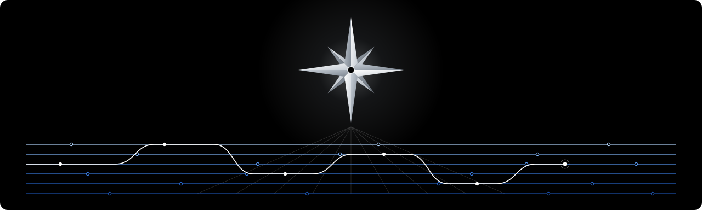

# overwatch

<p align="center">
  
</p>

A private command center for working with Claude Code: task management, cognitive offloading, and a second brain. You talk to the agent; the agent keeps state in plain-text local files that are never committed or published.

## Requirements

- macOS
- [Docker Sandboxes](https://docs.docker.com/ai/sandboxes/) (`sbx` CLI, free for local use)
- A Docker account and a Claude subscription

First time on this Mac? Install `sbx` and sign in with steps 1–3 of [`docs/sandbox-setup.md`](docs/sandbox-setup.md).

## Quickstart

From the repo root:

1. **Lock down the network** (one time). When asked for a network policy, choose **Locked Down**.
   ```
   ./scripts/lockdown.sh
   ```
2. **Start the sandbox** (terminal pane 1). First time only: type `/login` at the Claude prompt.
   ```
   ./scripts/run.sh
   ```
3. **Validate isolation** (terminal pane 2, while Claude is open). Every line should say `PASS`.
   ```
   ./scripts/validate-sandbox.sh
   ```
4. **Onboard** (first time only, at the Claude prompt): a short interview, one question at a time.
   ```
   /onboard
   ```

## Usage

At the Claude prompt:

| Command | When |
|---|---|
| `/checkin` | start of a session |
| `/sweep` | any time: clear the rooms, one topic at a time |
| `/checkout` | end of a session or day |
| `/archive` | monthly; the agent reminds you |

Exiting Claude stops the sandbox. Run `./scripts/run.sh` again to reattach.

## Docs

- [`docs/security.md`](docs/security.md): security boundaries, privacy, and known limits
- [`docs/how-it-works.md`](docs/how-it-works.md): files, skills, and scripts
- [`docs/memory-model.md`](docs/memory-model.md): how the agent stores and condenses memory
- [`docs/sandbox-setup.md`](docs/sandbox-setup.md): installing `sbx` and signing in

## License

PolyForm Noncommercial 1.0.0. See `LICENSE`.
