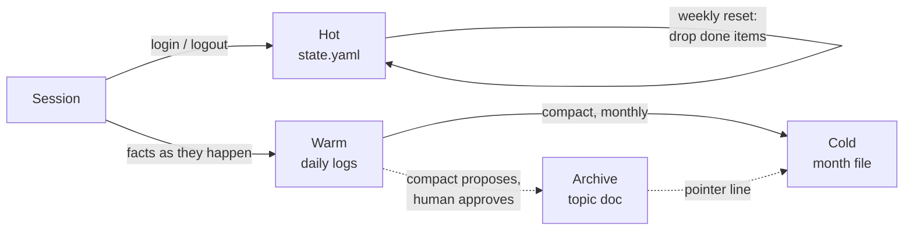

# Memory model

Overwatch's memory is plain text on disk, owned entirely by the agent. The human never reads or edits these files; they talk to the agent, and the agent keeps the record.

The design follows one principle: **recent is detailed, old is sparse, and detail survives only when someone decides it should.** Memory is sorted into tiers by age. Each tier has a fixed window, a fixed format, and a fixed way of moving into the next one.

## Layout

```
logbook/                          private, gitignored
  profile.yaml                    who the human is (outside the tiers)
  state.yaml                      HOT    this week
  2026/
    2026-11/                      WARM   one file per day, last ~4 weeks
      2026-11-07.md
      2026-11-08.md
    2026-10.md                    COLD   one compacted file per month
archive/                          private, gitignored, optional
  2026/
    2026-10/                      mirrors logbook/2026/2026-10/
      <topic>.md                  ARCHIVE  high-value detail, human-approved
```

Folders are created on demand. Empty months are never pre-created.

## Units

The system is built from five kinds of things:

| Unit | What it is | Where it lives |
|---|---|---|
| **Fact** | One line: one thing that happened, was decided, or was noticed | daily and month files |
| **State** | The live working set: focus, queue, todos, open loops, upcoming dates | `state.yaml` |
| **Profile** | Durable facts about the human: name, timezone, how to talk to them, what never to raise | `profile.yaml` |
| **Topic doc** | Rich detail too big for one line: numbers, reasoning, a plan | `archive/` |
| **Pointer** | A fact whose text links to a topic doc | month files |

## The tiers

### Hot: `state.yaml`
- **Window:** this week, Monday to Sunday.
- **Holds:** what is true *now*. `focus` (the single most important next thing), `queue` (prioritized), `todos`, `open_loops`, `dates`.
- **Format:** YAML, so the agent can change one field without rewriting prose.
- **Rule:** edited freely as work moves. Finished items are removed, because they already live in the daily log as `done:` facts.
- **Read:** first, every session. Usually this is all the agent needs.

### Warm: daily logs
- **Window:** roughly the last four weeks.
- **Holds:** what *happened*, in order, at full detail.
- **Format:** Markdown, one fact per line:

  ```
  - 14:05 [school] decision: exam moved to next weekend
  - 16:30 [home] done: laundry
  ```

- **Rule:** append-only in spirit. The agent corrects mistakes but does not rewrite history.
- **Read:** only when a request needs recent history.

### Cold: month files
- **Window:** anything older than about a month.
- **Holds:** what *mattered*. Decisions, milestones, lasting notes. Routine and superseded facts are dropped.
- **Format:** the same line format, with the date in place of the time. Aim for under ~40 lines per month.

  ```
  # 2026-10
  - 10-14 [work] decision: shipped the build system rewrite
  - 10-31 [school] done: practice exam passed
  - 10-22 [money] note: retirement model → archive/2026/2026-10/retirement-model.md
  ```

- **Read:** by grep, when a request reaches back further than a month.

## Line format

```
- HH:MM [tag] type: text      warm
- MM-DD [tag] type: text      cold
```

**Tags** say what area of life a fact belongs to: `work`, `school`, `health`, `money`, `home`, `overwatch`, `self`, `admin`.

**Types** say what kind of fact it is:

| Type | Meaning |
|---|---|
| `done` | something finished |
| `decision` | a choice that was made |
| `note` | something worth knowing later |
| `blocker` | something in the way |
| `start` | something begun |

One fact per line means a grep returns complete facts, never half a paragraph. The small fixed tag and type lists make searches precise: `grep -r "\[school\] decision" logbook/` finds every school decision ever made.

## Lifecycle



- **During a session** (`login`, `logout`): the agent updates `state.yaml` and appends facts to today's log.
- **Weekly reset** (first session after Sunday): `state.yaml` drops finished and stale items, sets a new `week_of`, and carries unfinished work forward unchanged. Nothing is lost; finished work is already in the logs.
- **Monthly compaction** (`compact`): one month of daily logs is condensed into one month file. The agent lists anything too rich to keep as a single line and asks the human which to archive. Only after the human confirms the result is the daily folder deleted.

Every transition that destroys detail needs a human yes. Everything else the agent does on its own.

## Archive: the optional extension

The three tiers are a complete system on their own. `archive/` is an extension that adds depth without adding weight to the tiers.

**It mirrors the logbook's date structure.** A topic doc from October 2026 lives at `archive/2026/2026-10/<topic>.md`, the same `YYYY/YYYY-MM` path as the logbook month it came from. That gives three properties:

- **One key everywhere.** The date path is the join key. `grep -r "2026-10" logbook/ archive/` finds the month file and every topic doc from that month together.
- **Pointers stay short.** The month file keeps one pointer line per topic doc, so it stays under ~40 lines no matter how much detail is archived.
- **The tiers never depend on it.** Deleting `archive/` loses depth but not the timeline. The month files still say what happened and when.

**Extending it.** Any future store can plug in the same way: mirror the `YYYY/YYYY-MM` path, and have the month file point into it. The tiers don't change, and the agent finds the new material through the same date keys and pointer lines it already uses.

## Profile: outside the tiers

`profile.yaml` doesn't age. It holds facts that stay true for months: name, timezone, communication preferences, what helps and what doesn't, topics never to raise. It's filled during `onboard` and changed only when a fact changes.

`CLAUDE.md` is public, so it holds only generic rules. Everything personal goes in `profile.yaml`.

## Invariants

- The agent is the only writer. The human talks; the agent records.
- Deleting detail (compaction) and promoting detail (archive) both require human approval.
- `logbook/` and `archive/` are gitignored and never published.
- YAML for state, Markdown for logs, no JSON.
- One fact per line, always tagged and typed.
